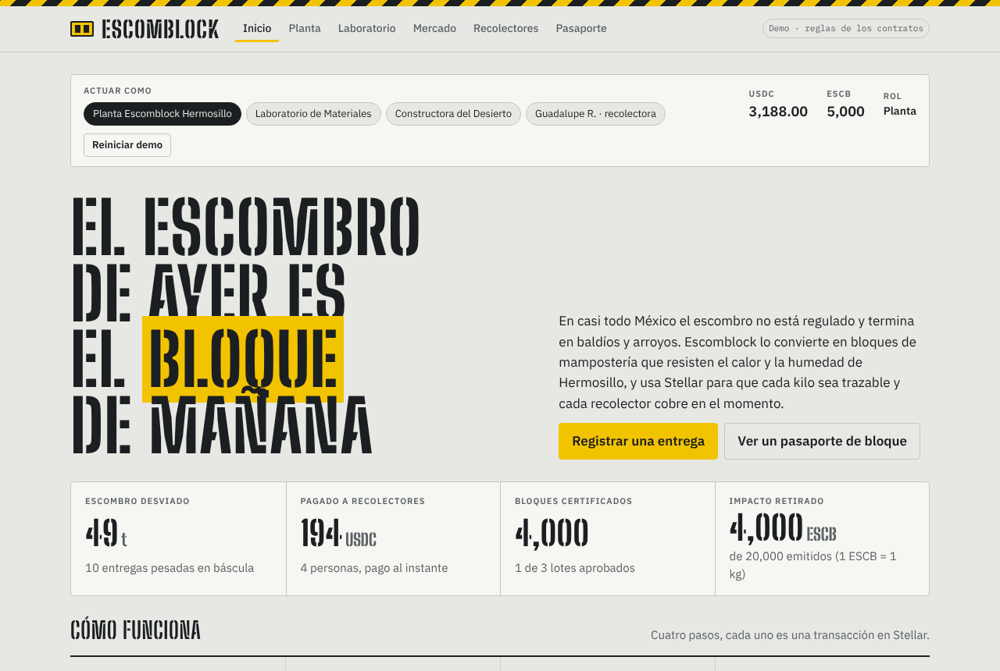
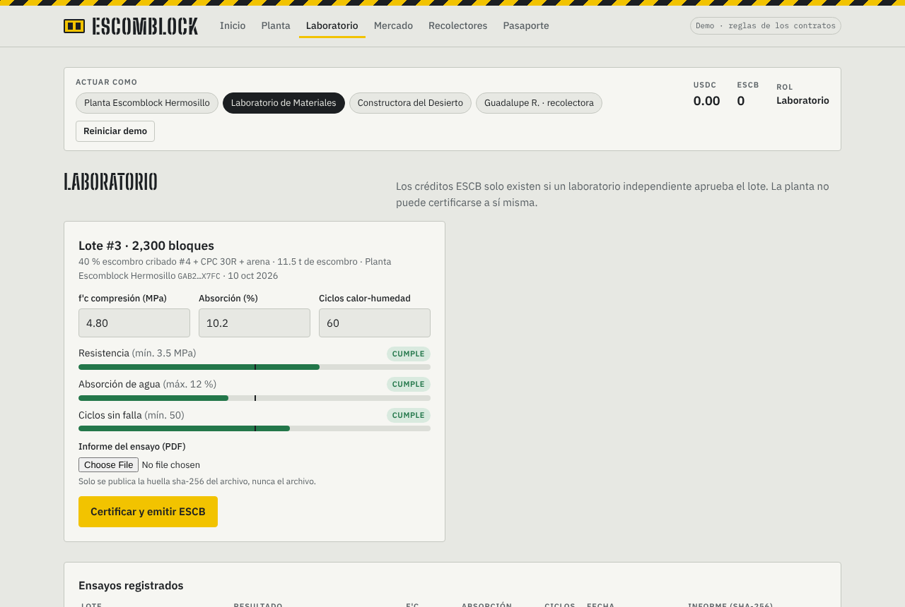
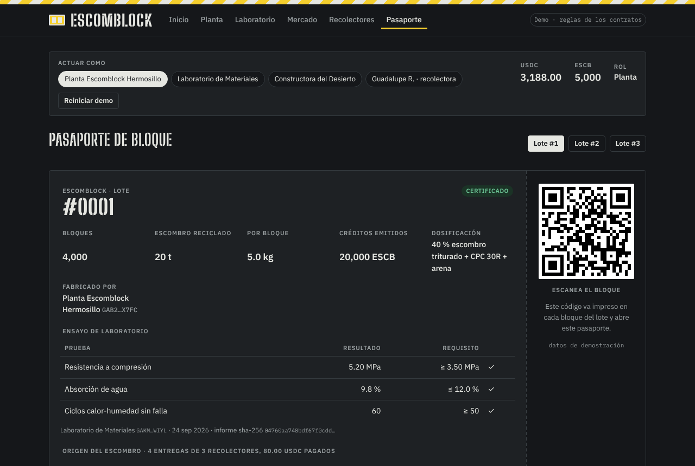
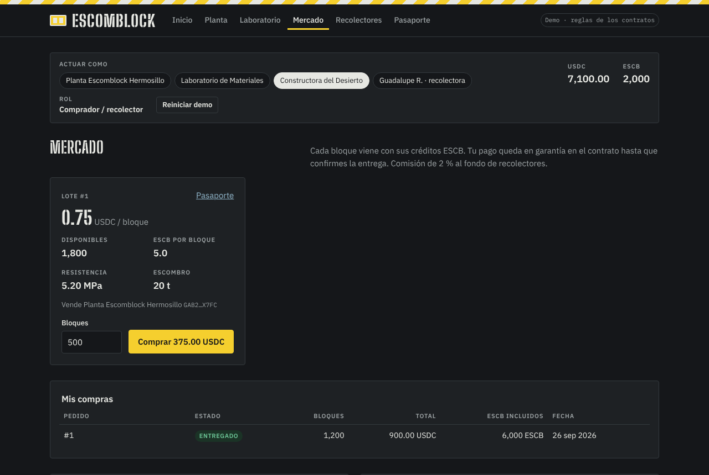

# Escomblock

**Construction rubble → certified building blocks → paid collectors, traceable on Stellar.**

*Escombro + block.* Escomblock began as a student research project: a masonry block made with recycled construction rubble that stays strong and well-bonded in the heat and water exposure of Hermosillo, Sonora. This repository turns that research into a working circular-economy platform on **Stellar + Soroban**.

> 🇪🇸 [Resumen en español](#resumen-en-español) · 🎬 [Pitch video script](docs/PITCH.md) · 🧱 [Architecture](docs/ARCHITECTURE.md) · ✅ [Submission checklist](docs/SUBMISSION.md)

---

| Home | Lab certification |
| --- | --- |
|  |  |
| **Block passport** | **Market** |
|  |  |

## The problem

- In most of Mexico, construction and demolition rubble (*escombro*) is practically unregulated. It ends up in vacant lots, roadsides and dry riverbeds. The research behind Escomblock found only one company recycling it, selling it as cheap fill to level land.
- The people who move rubble are often informal workers paid in cash, late, or not at all, with no record of the work they do.
- Recycled materials have a trust problem: builders don't know whether a "green" block is actually strong, and companies that claim to recycle can't prove how much they diverted, or they count the same impact twice.

## The solution

Escomblock connects four actors through two Soroban contracts:

| Step | Who | What happens on Stellar |
| --- | --- | --- |
| 1. **Scale ticket** | Plant + collector | The plant weighs a rubble delivery; `record_delivery` pays the collector **USDC in the same transaction** (0.004 USDC/kg by default = 4 USDC per tonne). |
| 2. **Batch** | Plant | `create_batch` groups deliveries into a production batch. Every kilo stays linked to its origin; a delivery can never be used twice. |
| 3. **Lab certification** | Independent lab | `certify_batch` records compressive strength, water absorption, heat-humidity cycles and the SHA-256 of the lab report. If the batch meets the standard, the contract **mints ESCB credits** (1 ESCB = 1 kg of rubble diverted) to the plant. A plant can never certify itself. |
| 4. **Market + retirement** | Builder | The builder buys blocks with USDC held in **escrow**. On delivery the plant is paid (minus a 2 % fee to a collectors' fund) and the ESCB that belong to those blocks move to the builder, who can `retire` them to claim the impact. Retired credits are burned. |

Every batch has a public **block passport** (lab results + every source delivery + who was paid) behind a QR code printed on the blocks.

## Why Stellar

- **Micropayments that make sense.** A rubble delivery is worth 10–30 USDC. Sub-cent fees and ~5 s finality make paying every single trip viable; Stellar anchors let collectors cash out to local currency.
- **Credits are real Stellar assets.** ESCB is a classic Stellar asset whose Stellar Asset Contract (SAC) admin is the Escomblock contract. Only certified batches can mint it, yet it shows up in any wallet, can be traded on the DEX, and is burned on retirement.
- **Rules in Soroban, not in a spreadsheet.** Roles, double-use protection, lab independence, escrow and timeouts are enforced on-chain and covered by 20 unit tests.
- **USDC via SAC.** Payouts and purchases use the USDC Stellar Asset Contract, so the same code runs with Circle's testnet/mainnet USDC.

## Repository

```
contracts/
  escomblock/        core: roles, deliveries + payouts, batches, lab certification, ESCB mint, retirement, passport
  market/            escrowed marketplace for certified blocks, bundling ESCB with each block
app/                 React + Vite dApp (Freighter wallet, live testnet mode + offline demo mode)
scripts/
  deploy-testnet.sh  build, deploy, wire assets & roles, optional seed, write app/.env.local
  artifact-page.py   turn the single-file demo build into a hostable page
docs/                architecture, pitch video script, submission checklist
```

## Run it

### Contracts

```bash
rustup target add wasm32v1-none
cargo test                                         # 20 tests: core (12) + market (8)
stellar contract build                             # or: cargo build --target wasm32v1-none --release
```

### Deploy to testnet

```bash
cargo install --locked stellar-cli                 # v23+
./scripts/deploy-testnet.sh --seed                 # creates & funds accounts, deploys, seeds one full flow
```

The script creates `escomblock-{admin,plant,lab,builder,collector}` keys with friendbot, issues test USDC and ESCB, deploys both contracts, hands ESCB minting to the core contract, registers roles, and writes the contract ids to `app/.env.local`. Import a role into Freighter with `stellar keys show escomblock-plant`.

### dApp

```bash
cd app
npm install
npm run dev                # http://localhost:5173
```

- Without `app/.env.local` the app runs in **demo mode**: an in-browser simulation that applies the same rules as the contracts, preloaded with a realistic Hermosillo dataset. Switch actor (plant, lab, builder, collector) to walk the whole flow without a wallet.
- With `app/.env.local` it runs against **Stellar testnet** and signs with **Freighter**; the header toggles between live and demo.
- `npm run build:artifact` produces one self-contained demo HTML file.

## Contract API (core)

| Function | Auth | Notes |
| --- | --- | --- |
| `__constructor(admin, usdc, credit, price_per_kg, standard)` | – | `credit` = ESCB SAC; call `set_admin(core)` on it afterwards |
| `set_role(account, Plant\|Lab, enabled)` / `set_params` / `set_admin` | admin | |
| `record_delivery(plant, collector, kg, origin) -> id` | plant | pays `kg × price_per_kg` USDC plant → collector |
| `create_batch(plant, delivery_ids, blocks, mix) -> id` | plant | ≤ 50 deliveries, each used once, same plant |
| `certify_batch(lab, batch_id, strength_mpa_x100, absorption_pct_x100, thermal_cycles, report_hash) -> passed` | lab ≠ plant | mints `rubble_kg × 10^7` ESCB stroops on pass |
| `retire(from, amount, beneficiary) -> id` | holder | burns ESCB, keeps a permanent record |
| `passport`, `batch`, `delivery`, `certification`, `retirement`, `stats`, `counts`, `config`, `has_role`, `batch_summary` | – | views |

Market: `list`, `delist`, `buy`, `ship`, `confirm`, `claim` (after `claim_after` seconds), `cancel` (before shipping), views `listing`, `order`, `counts`, `config`. Details in [docs/ARCHITECTURE.md](docs/ARCHITECTURE.md).

The certification standard is configurable. Defaults (3.5 MPa minimum compressive strength, 12 % maximum absorption, 50 heat-humidity cycles) are demo reference values; a deployment should set them from the applicable norm (e.g. NMX-C-441-ONNCCE in Mexico, NCh 181/182 in Chile) with its partner lab.

## Roadmap

1. Pilot with one block plant and one university materials lab in Hermosillo; same model for Chilean cities.
2. Collector onboarding with a passkey smart wallet (no seed phrase) and cash-out through a local anchor (SEP-24).
3. Municipal dashboard: rubble diverted per neighbourhood, from the public on-chain data.
4. Sell ESCB retirements to builders who need to report waste management for green-building certifications.

## Resumen en español

**Escomblock** es un proyecto de investigación estudiantil que propone un bloque de mampostería hecho con escombro reciclado, capaz de resistir el calor y la humedad de Hermosillo, Sonora. En casi todo México el escombro no está regulado; este proyecto lo convierte en material de construcción certificado y usa **Stellar** para:

- **Pagar al instante en USDC** a quienes recolectan y entregan escombro, en la misma transacción en que se pesa.
- **Trazar cada kilo** desde la demolición hasta el bloque, con un **pasaporte público** por lote (QR en cada bloque).
- **Certificar con un laboratorio independiente** (resistencia, absorción, ciclos de calor-humedad y huella SHA-256 del informe). Solo los lotes aprobados emiten **créditos ESCB** (1 ESCB = 1 kg de escombro desviado).
- **Vender con garantía (escrow)**: la constructora paga en USDC, el pago se libera al confirmar la entrega y los ESCB de esos bloques pasan a la constructora, que puede **retirarlos** para reclamar el impacto sin doble conteo.

La app funciona en **modo demo** (sin wallet, mismas reglas que los contratos) y en **modo testnet** con Freighter. Ver [docs/PITCH.md](docs/PITCH.md) para el guion del video y [docs/SUBMISSION.md](docs/SUBMISSION.md) para la lista de entrega del hackathon.

## License

MIT
