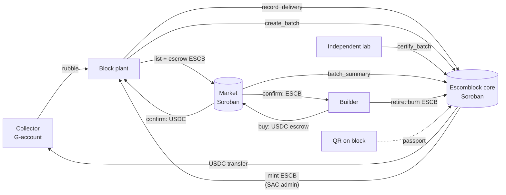

# Architecture



## Contracts

### `contracts/escomblock` (core)

State (all records in persistent storage with TTL extension; config, stats and counters in instance storage):

| Key | Value |
| --- | --- |
| `Config` | admin, USDC SAC, ESCB SAC, `price_per_kg`, `Standard` |
| `Stats` | deliveries, rubble kg, USDC paid, batches, certified batches/blocks, credits minted/retired, retirements |
| `Role(address, Plant\|Lab)` | `true` |
| `Delivery(id)` | plant, collector, kg, origin, payout, timestamp, `batch_id` (0 = unused) |
| `Batch(id)` | plant, delivery ids, rubble kg, blocks, mix, status, created_at, credits minted |
| `Certification(batch_id)` | lab, strength ×100, absorption ×100, cycles, report SHA-256, passed, timestamp |
| `Retirement(id)` | by, amount, beneficiary, timestamp |

Invariants enforced on-chain:

- Only registered plants record deliveries and create batches; only registered labs certify.
- A plant cannot pay itself and cannot certify its own batch (even if it also holds the Lab role).
- A delivery belongs to one plant and is consumed by at most one batch.
- A batch is evaluated once; ESCB is minted only on pass, exactly `rubble_kg` whole credits.
- ESCB can only be minted by the core contract (it is the SAC admin) and is burned on retirement.

Events: `RoleSet`, `RubbleDelivered`, `BatchCreated`, `BatchCertified`, `CreditsRetired` (via `#[contractevent]`), so indexers can rebuild history.

### `contracts/market`

- `list` checks `batch_summary` on the core contract (certified + owner), never lists more blocks than the batch produced, and escrows `credits_per_block × qty` ESCB.
- `buy` escrows USDC. `ship` (seller) → `confirm` (buyer) settles: fee to treasury, rest to seller, ESCB to buyer.
- `cancel` refunds before shipping; if the listing was closed meanwhile, the order's ESCB goes back to the seller.
- `claim` lets the seller settle a shipped order the buyer never confirmed after `claim_after` seconds.
- Fee capped at 10 % (`MAX_FEE_BPS`).

## Assets

| Asset | Type | Admin |
| --- | --- | --- |
| USDC | Classic asset + SAC (test issuer on testnet, or Circle USDC) | issuer |
| ESCB | Classic asset `ESCB:<issuer>` + SAC | **core contract** (`set_admin` after deploy) |

Using SAC for ESCB means credits are first-class Stellar assets: visible in wallets, tradable on the SDEX, and their supply is auditable by anyone. G-accounts need a trustline (`deploy-testnet.sh` creates them for the demo accounts).

## dApp

```
app/src/lib/types.ts    domain types + Api interface
app/src/lib/demo.ts     DemoApi: in-browser port of the contract rules with seed data (Hermosillo)
app/src/lib/soroban.ts  SorobanApi: contract.Client.from(...) + Freighter signing, error-code mapping
app/src/views/*         Inicio, Planta, Laboratorio, Mercado, Recolectores, Pasaporte
```

Both APIs implement the same interface, so every screen works identically in demo and live mode. The live client loads each contract's spec from the network, so no generated bindings need to be kept in sync.

## Tests

`cargo test` runs 20 tests:

- core: instant payout, full flow (certify → mint → passport → retire), failing lab test, heat-cycle requirement, delivery reuse, cross-plant reuse, unregistered actors, self-certification, double certification, revoked roles, invalid inputs, admin params.
- market: list → buy → ship → confirm → retire, uncertified batch, ownership and over-listing, cancel/refund, cancel after shipping, claim timeout, delist + cancel credit return, guards.
