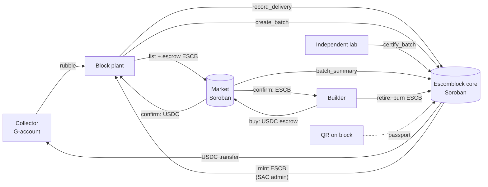

# Architecture



## Contracts

### `contracts/escomblock` (core)

State (all records in persistent storage with TTL extension; config, stats and counters in instance storage):

| Key | Value |
| --- | --- |
| `Config` | admin, USDC SAC, ESCB SAC, `price_per_kg`, `Standard` |
| `Stats` | deliveries, rubble kg, USDC paid, batches, certified batches/blocks, credits minted/retired, retirements |
| `Role(address, Plant\|Lab)` | `true` |
| `Delivery(id)` | plant, collector, kg, origin, payout, timestamp, `batch_id` (0 = unused) |
| `Batch(id)` | plant, delivery ids, rubble kg, blocks, mix, status, created_at, credits minted |
| `Certification(batch_id)` | lab, strength ×100, absorption ×100, cycles, report SHA-256, passed, timestamp |
| `Retirement(id)` | by, amount, beneficiary, timestamp |

Invariants enforced on-chain:

- Only registered plants record deliveries and create batches; only registered labs certify.
- A plant cannot pay itself and cannot certify its own batch (even if it also holds the Lab role).
- A delivery belongs to one plant and is consumed by at most one batch.
- A batch is evaluated once; ESCB is minted only on pass, exactly `rubble_kg` whole credits.
- ESCB can only be minted by the core contract (it is the SAC admin) and is burned on retirement.

Events: `RoleSet`, `RubbleDelivered`, `BatchCreated`, `BatchCertified`, `CreditsRetired` (via `#[contractevent]`), so indexers can rebuild history.

Operations: `set_paused` stops every write (views keep working), `upgrade` swaps the Wasm in place, `set_admin` hands control to a new (e.g. multisig) account.

### `contracts/market`

- `list` checks `batch_summary` on the core contract (certified + owner), never lists more blocks than the batch produced, and escrows `credits_per_block × qty` ESCB.
- `buy` escrows USDC. `ship` (seller) → `confirm` (buyer) settles: fee to treasury, rest to seller, ESCB to buyer.
- `cancel` refunds before shipping; if the listing was closed meanwhile, the order's ESCB goes back to the seller.
- `claim` lets the seller settle a shipped order the buyer never confirmed after `claim_after` seconds.
- Fee capped at 10 % (`MAX_FEE_BPS`).

## Assets

| Asset | Type | Admin |
| --- | --- | --- |
| USDC | Circle USDC + its SAC on mainnet (a throwaway test issuer on local/testnet seeds) | Circle |
| ESCB | Classic asset `ESCB:<issuer>` + SAC | **core contract** (`set_admin` after deploy) |

Using SAC for ESCB means credits are first-class Stellar assets: visible in wallets, tradable on the SDEX, and their supply is auditable by anyone. G-accounts need a trustline; the dApp's wallet bar adds the USDC and ESCB trustlines with one click.

After `set_admin`, `scripts/deploy.sh mainnet` locks the ESCB issuer (master weight 0), so classic issuance is impossible and the contract is the only source of ESCB. The asset is described for wallets in a SEP-1 `stellar.toml`.

## dApp

```
app/src/lib/types.ts    domain types
app/src/lib/config.ts   network presets (mainnet with Circle USDC, testnet, local) and contract ids from VITE_* vars
app/src/lib/soroban.ts  SorobanApi: contract.Client.from(...) reads (no wallet needed), Freighter signing,
                        trustline activation, contract error codes mapped to Spanish messages
app/src/views/*         Inicio, Planta, Laboratorio, Mercado, Recolectores, Pasaporte
```

The client loads each contract's spec from the network, so no generated bindings need to be kept in sync. Each collection is read with one paged call (`deliveries`, `batches`, `retirements`, `listings`, `orders`; up to 50 records), so a page refresh costs a handful of RPC requests, not one per record. The app refreshes every 30 s.

## Tests

`cargo test` runs 28 tests:

- core: instant payout, full flow (certify → mint → passport → retire), failing lab test, heat-cycle requirement, delivery reuse, cross-plant reuse, unregistered actors, self-certification, double certification, revoked roles, invalid inputs, admin params, pause, paged views and page-size cap, self-registration only while open roles are enabled (and still no self-certification).
- market: list → buy → ship → confirm → retire, uncertified batch, ownership and over-listing, cancel/refund, cancel after shipping, claim timeout, delist + cancel credit return, guards, pause (open orders still settle), paged views.
- faucet: test-USDC claim with a per-account cooldown.

`npm run test:it` (app) runs the dApp's Stellar layer against a live network deployed by `OPEN=1 scripts/deploy.sh local --seed`: reading without a wallet, trustline activation, role errors, self-registration plus faucet, and the full pay → batch → certify → list → buy → ship → confirm → retire flow. CI runs it on a Dockerized `stellar/quickstart` network on every push.

## Public test sandbox

Test deployments made with `OPEN=1` (the testnet workflow does this) are a free-to-try sandbox:

- `set_open_roles(true)` lets any account call `join(account, Plant|Lab)` to register itself. Every other rule still applies; in particular a lab can never certify a batch from its own plant account, so trying the full flow takes two Freighter accounts.
- `contracts/faucet` becomes the admin of the test USDC asset and gives 1,000 test USDC per account per hour.
- The app shows "Obtener XLM de prueba" (friendbot), "Pedir USDC de prueba" and "Registrarme como planta / laboratorio" buttons.

Mainnet deployments never enable open roles and never deploy the faucet: roles are granted by the admin and payouts use Circle USDC.
